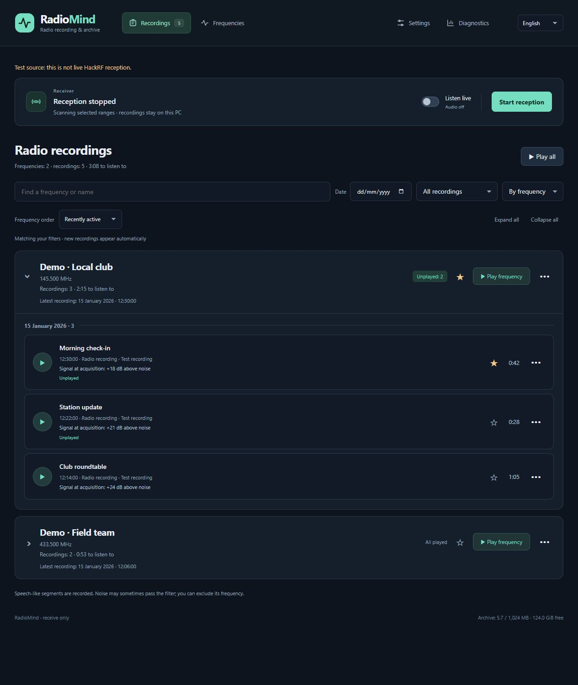

# RadioMind


**A local, RX-only radio scanner and conversation archive.**

[English](README.md) · [Українська](README.uk.md) · [Русский](README.ru.md)

Scan configured ranges, hold a conversation to its end, then resume scanning. Browse recordings grouped by frequency, rename groups and recordings, use favorites and a blacklist, and listen live to accepted analog audio. The interface supports English, Ukrainian and Russian.

[Installation and user guide](docs/en/guide.md) · [Architecture / formats](docs/en/architecture.md) · [Changelog](CHANGELOG.md)



*Illustrative English UI with invented data and silent test recordings; no real RF
or user archive. See [receiver settings](docs/en/guide.md#configure-reception).*

## Windows — demo

Download the repository with **Code → Download ZIP** and extract it, or clone it
with Git. Open a terminal in the extracted project folder.

Python 3.11–3.13 x64:

```powershell
powershell -File scripts/windows/setup.ps1
powershell -File scripts/windows/start.ps1
```

For an installed and configured receiver, double-click
[Start RadioMind.cmd](Start%20RadioMind.cmd). It opens the browser and reuses an
existing instance. See the guide for USB setup and the private RX profile.

## Linux x64 — demo

Python 3.11–3.13:

```sh
sh scripts/linux/setup.sh
sh scripts/linux/start.sh
```

http://127.0.0.1:8765/ — mock, no USB / RF. [Installation and user guide](docs/en/guide.md).

## Status

Windows x64 is the primary hardware-tested platform. Linux x64 has a setup and CI path; field reception on Linux still needs validation. Raspberry Pi is deferred. RNNoise cleanup copies are currently Windows-only. Digital formats are experimental; trunk following and encrypted audio decoding are not supported.

## License

Original source: GPL-3.0-only; explicit per-file exceptions retain their notices. External dependencies keep their own licenses.

[LICENSE](LICENSE) · [Third-party notices](THIRD_PARTY.md) · [Contributing](CONTRIBUTING.md) · [Security](SECURITY.md)
