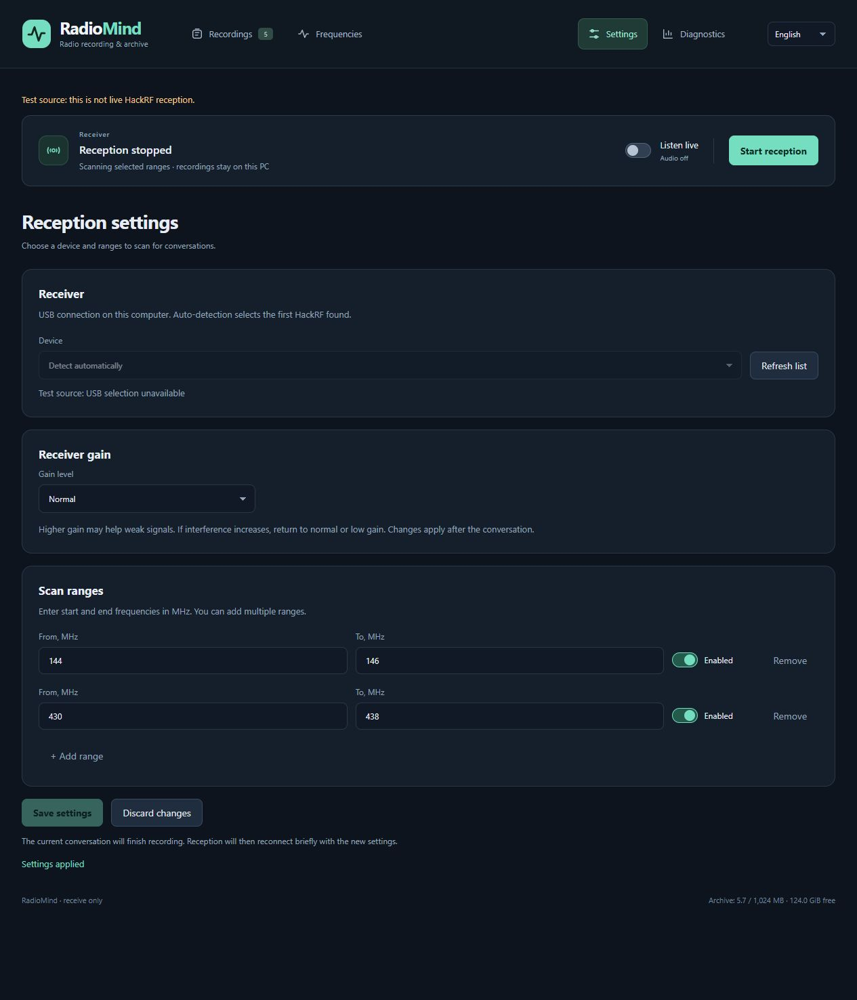

# Встановлення та використання

[English](../en/guide.md) · [Українська](guide.md) · [Русский](../ru/guide.md)

## Вимоги та підтримка

Потрібні повний каталог вихідного коду, CPython 3.11–3.13 **64-біт**, сучасний
браузер і місце для архіву. Основна перевірена платформа — Windows 10/11 x64.
Встановлення Linux x64 розраховане на Ubuntu 24.04 / Debian 12 або новіші з
відповідним Python; реальне приймання під Linux ще потребує перевірки. Raspberry
Pi відкладено. Захоплення працює на 8 MS/s; нижчу частоту для Pi не реалізовано.

Один приймач і один архів мають належати одному екземпляру застосунку. Закрийте
інші SDR-програми перед апаратним прийманням. Почніть із демо: воно не відкриває
USB та не записує ефір. Встановлення завантажує залежності; під час приймання звук
не надсилається до хмари. Node.js 22 потрібен лише для перевірок розробки.

## Windows

Після встановлення й налаштування приймача запускайте **Start RadioMind.cmd**
подвійним клацанням у корені проєкту. Сервер працює у фоні, браузер відкривається
автоматично. Використовується `config/local.yaml`, а за його відсутності — наявний
`config/hackrf-recorder.yaml`. Повторний запуск відкриває чинний екземпляр і не
змінює стан приймання. Закриття браузера не зупиняє приймання — використовуйте кнопку
зупинки в інтерфейсі. Помилки залишаються у вікні запуску, журнали зберігаються в
`runtime/windows-launch-*.log`. Можна створити ярлик CMD-файлу на робочому столі;
сам файл має залишатися в каталозі проєкту поруч із папкою `scripts`.

Встановіть Python x64 з доступною командою `python`. У корені проєкту виконайте:

```powershell
powershell -File scripts/windows/setup.ps1
powershell -File scripts/windows/start.ps1
```

Відкрийте http://127.0.0.1:8765/. Зупинка — Ctrl+C. Встановлення створює `.venv`,
додає зафіксовані залежності та backend у режимі editable. USB-драйвер не змінюється,
приймання не запускається. Зберігайте backend разом з усім деревом вихідного коду.

Для аналогового приймання встановіть модель детекції мовлення та бібліотеку HackRF:

```powershell
powershell -File scripts/windows/setup.ps1 -Models -HackRF
```

Потрібен сумісний USB-драйвер HackRF. Скористайтеся
[офіційною інструкцією HackRF](https://hackrf.readthedocs.io/en/latest/installing_hackrf_software.html).
Скрипти проєкту не перепрошивають пристрій. Додатково: `setup.ps1 -Cleanup`
встановлює RNNoise, `setup.ps1 -Digital` — DSD-neo. Спочатку прочитайте
[умови сторонніх компонентів](../../THIRD_PARTY.md).

Якщо політика PowerShell блокує скрипти, запустіть `python scripts/bootstrap.py`
та `.venv/Scripts/python.exe -m radiomind` для демо без зміни системної політики.
Додаткові інсталятори також можна викликати напряму через Python із venv.

## Linux x64

Ubuntu 24.04 / Debian 12:

```sh
sudo apt update
sudo apt install python3 python3-venv libhackrf0 hackrf
sh scripts/linux/setup.sh
sh scripts/linux/start.sh
```

Якщо системний Python не належить до 3.11–3.13, виберіть встановлену сумісну версію:
`PYTHON=python3.12 sh scripts/linux/setup.sh`. Використовуйте venv без `sudo pip`.
Модель мовлення: `sh scripts/linux/setup.sh --models`. Для цифрового декодера
додайте `--digital`; зафіксований AppImage x64 розпаковується локально без FUSE.
Очищення копій RNNoise поки доступне лише у Windows; Linux зберігає приймання та
відтворення оригіналів.

Пакет HackRF надає правила USB. Після встановлення перепідключіть пристрій та
перевірте доступ звичайного користувача. Не запускайте вебзастосунок від root.
Версія системної libhackrf залежить від дистрибутива й не фіксується через pip.
Для апаратних перевірок збережіть результат `dpkg-query -W libhackrf0`.

## Налаштування приймання



*Англійський демо-інтерфейс, приклад діапазонів, приймач не підключено. Вибір USB
у mock-режимі недоступний. Для відтворення: `python scripts/demo.py`, потім
http://127.0.0.1:8766/. Окремий тимчасовий архів містить лише записи тиші.
Зупинка — Ctrl+C.*

Нижче наведено приклади синтаксису, а не дозвіл на конкретні частоти. Замініть `XX`,
підставу дозволу та діапазон власними даними. Генератор створює локальний файл,
виключений із Git, не перезаписує наявний і не запускає приймання. Для кількох
діапазонів повторюйте `--range ПОЧАТОК:КІНЕЦЬ` у МГц.

Windows:

```powershell
.venv/Scripts/python.exe scripts/configure.py --country XX --basis "My RX authorization" --range 144:146 --record-audio
.venv/Scripts/python.exe scripts/doctor.py --config config/local.yaml --hackrf-library tools/hackrf/Library/bin/hackrf-0.dll
powershell -File scripts/windows/start.ps1 -Config config/local.yaml -ApproveRx
```

Linux:

```sh
.venv/bin/python scripts/configure.py --country XX --basis "My RX authorization" --range 144:146 --record-audio
RADIO_LIBRARY=$(dpkg -L libhackrf0 | sed -n '/\/libhackrf\.so\.0$/p' | head -n 1)
test -f "$RADIO_LIBRARY"
.venv/bin/python scripts/doctor.py --config config/local.yaml --hackrf-library "$RADIO_LIBRARY"
sh scripts/linux/start.sh --config config/local.yaml --approve-rx --hackrf-library "$RADIO_LIBRARY"
```

Для іншого дистрибутива вкажіть повний шлях до `.so`. `doctor.py` не відкриває USB;
успішний результат не підтверджує роботу обладнання. Після встановлення DSD-neo
додайте `--digital` під час створення профілю. Генератор увімкне IQ-вхід і проби
DMR/D-STAR/P25-II. Наявний YAML редагуйте після зупинки застосунку; цифровий режим
потребує дозволу на аудіозапис. TETRA вмикається окремо та є експериментальним.

Вибір USB, підсилення й діапазони з вебналаштувань зберігаються в SQLite та під час
наступного запуску мають пріоритет над YAML. Після зміни профілю перевірте вкладку
«Налаштування». Зміни застосовуються після поточної розмови; вимкнення всіх
діапазонів зупиняє приймання. Запускайте лише потрібні діапазони з потрібними дозволами.

## Щоденне використання


*Назви, дати й рівні сигналу вигадані; це ілюстрація інтерфейсу, а не перевірка приймання.*

- **Записи:** розгорніть групу частоти та слухайте записи. Меню дозволяє перейменувати
  запис чи групу, додати частоту до обраного або чорного списку. Видалення групи
  видаляє її записи після підтвердження.
- **Налаштування:** конкретний USB HackRF або автоматичний пошук, підсилення,
  діапазони та перемикачі їхньої активності. Збереження застосовує зміни, скасування
  відкидає чернетку.
- **Слухати ефір:** аналоговий звук під час запису. Попередній буфер додає затримку;
  відтворення працює незалежно й не блокує збереження архіву.
- **Очищена копія:** RNNoise у Windows зберігає оригінал. Порівняйте обидві версії;
  покращення залежить від характеру шуму.
- **Рівень приймання:** перевищення оціненого шумового порога в момент захоплення,
  у дБ. Це не калібрована потужність dBm і не оцінка розбірливості мовлення.
- **Діагностика:** помилки приймання, втрати буфера й спроби декодування. Невідомий
  формат або одинична синхронізація не доводять шифрування чи наявності мовлення.

Під час утримання розмови сканування призупинено: інші частоти можна пропустити.
Попередній буфер не повертає сигнал, який був до налаштування на частоту.
Створений профіль обмежує сегмент 180 секундами, архів — 1024 МБ. Для тривалої роботи
перевірте `audio`: заповнення квоти зупиняє нове захоплення, старі записи автоматично
не видаляються. Транскрипції, супроводу транкінгу й обходу шифрування немає.
Цифрові формати експериментальні: DMR перевірено на публічних референсах, більшість
інших — на синтетиці; dPMR/P25-II/TETRA ще не мають повної перевірки розбірливого
голосу. [Докладна матриця](../en/architecture.md).

## Зберігання, оновлення та віддалена робота

`data/` — SQLite й аудіо, `runtime/` — діагностика, `tools/` — моделі та бібліотеки,
`config/local.yaml` — початковий профіль. Ці файли не входять до експорту коду.
Інший диск: `--data-dir ШЛЯХ`, у Windows-скрипті `-DataDir ШЛЯХ`.
Резервуйте весь каталог даних після зупинки застосунку: копіювання лише основного
файлу SQLite під час запису WAL не дає узгодженої резервної копії.

Перед оновленням зупиніть приймання, збережіть дані й конфігурацію, замініть код та
повторіть setup. Зберігайте сумісні версії залежностей і моделей. Автоматичне
повернення старої схеми БД не гарантоване. Не запускайте два процеси запису в один архів.

Авторизації немає; сервер слухає лише localhost. Для майбутньої Linux VM у Proxmox
потрібні ексклюзивне передавання USB та постійний диск даних. Продуктивність у VM
не перевірено; готового контейнера чи інструкції LXC в цьому випуску немає.
Для віддаленого доступу зі свого комп'ютера використовуйте SSH-тунель:

```sh
ssh -N -L 8765:127.0.0.1:8765 user@your-server
```

Відкрийте звичайну локальну адресу. Не публікуйте порт застосунку без авторизації.

## Помилки та перевірки

Для DMR потрібне повторне підтвердження виклику до прийняття декодованого звуку.
Підтримувані заголовки захисту дають ознаку шифрування; сама нерозбірливість — ні.
У нових захопленнях об'єднуються лише суворо зіставлені дублікати виходу слотів;
різні доріжки зберігаються. Короткі виклики без достатніх заголовків можуть лишитися
непідтвердженими. Ці перевірки не доводять розбірливість і не змінюють старі записи.

Сторінка не відкривається: перевірте термінал запуску й порт. Для другого демо
виберіть інший порт. Пристрою не видно: кабель, драйвер, USB-права та зайнятість
іншою SDR-програмою. Для VM/WSL див.
[діагностику HackRF](https://hackrf.readthedocs.io/en/stable/troubleshooting.html).
Переповнення: збережіть лічильники, зменште конкурентне навантаження CPU/диска та
USB; не приховуйте пропуски. Не запускайте важкі бенчмарки під час збору.

Немає моделі чи декодера: запустіть відповідний інсталятор і `doctor.py`.
Немає записів: перевірте діапазони, дозвіл запису, рівень сигналу, чорний список та
квоту. Для повідомлень про помилки використовуйте синтетику або дозволені до
поширення референси; приватний ефір не публікуйте.

Запустіть `python scripts/check.py` із venv: lint, форматування, типи, unit/API,
фронтенд і перевірка публічного складу. Апаратні та нативні перевірки виконуються
окремо. Див. [фактичні результати](validation.md) та [участь](../../CONTRIBUTING.md).
